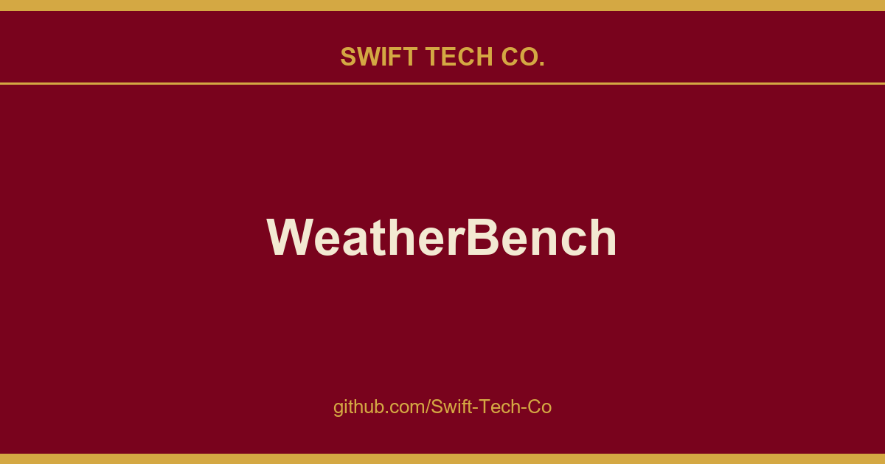

# WeatherBench

## What This Is

We keep a working index for product and engineering, and WeatherBench is the entry that collects our notes, examples and fixes. It reflects how Swift Tech Co. actually uses this in builds and client work.

## Images

[](https://github.com/Swift-Tech-Co/WeatherBench)

## Leaderboard
| Model | Z500 RMSE (3 / 5 days) [m<sup>2</sup>/s<sup>2</sup>] | T850 RMSE (3 / 5 days) [K] | Notes | Reference |
|--------------------|----------------------------------|----------------------------|----------------------|------------------|
| Operational IFS | 154 / 334 | 1.36 / 2.03 | ECWMF physical model (10 km) | Rasp et al. 2020 |
| Rasp and Thuerey 2020 (direct/continuous) | **268 / 499** | **1.65 / 2.41** | Resnet with CMIP pretraining (5.625 deg) | Rasp and Thuerey 2020 |
| IFS T63 | 268 / 463 | 1.85 / 2.52 | Lower resolution physical model (approx. 1.9 deg) | Rasp et al. 2020 |
| Weyn et al. 2020 (iterative) | **373 / 611** | **1.98 / 2.87** | UNet with cube-sphere mapping (2 deg) | Weyn et al. 2020 |
| Clare et al. 2021 (direct) | 375 / 627 | 2.11 / 2.91 | Stacked ResNets with probabilistic output (5.625 deg) | Clare et al. 2021 |
| IFS T42 | 489 / 743 | 3.09 / 3.83 |Lower resolution physical model (approx. 2.8 deg)  | Rasp et al. 2020 |
| Weekly climatology | 816 | 3.50 | Climatology for each calendar week | Rasp et al. 2020 |
| Persistence | 936 / 1033 | 4.23 / 4.56 |  | Rasp et al. 2020 |
| Climatology | 1075 | 5.51 |  | Rasp et al. 2020 |

## Quick start
You can follow the quickstart guide in this notebook or lauch it directly from Binder.

## Download the data
The data is hosted here with the following directory structure

```
.
|-- 1.40625deg
|   |-- 10m_u_component_of_wind
|   |-- 10m_v_component_of_wind
|   |-- 2m_temperature
|   |-- constants
|   |-- geopotential
|   |-- old
|   |   `-- temperature
|   |-- potential_vorticity
|   |-- relative_humidity
|   |-- specific_humidity
|   |-- temperature
|   |-- toa_incident_solar_radiation
|   |-- total_cloud_cover
|   |-- total_precipitation
|   |-- u_component_of_wind
|   |-- v_component_of_wind
|   `-- vorticity
|-- 2.8125deg
|   |-- 10m_u_component_of_wind
|   |-- 10m_v_component_of_wind
|   |-- 2m_temperature
|   |-- constants
|   |-- geopotential
|   |-- potential_vorticity
|   |-- relative_humidity
|   |-- specific_humidity
|   |-- temperature
|   |-- toa_incident_solar_radiation
|   |-- total_cloud_cover
|   |-- total_precipitation
|   |-- u_component_of_wind
|   |-- v_component_of_wind
|   `-- vorticity
|-- 5.625deg
|   |-- 10m_u_component_of_wind
|   |-- 10m_v_component_of_wind
|   |-- 2m_temperature
|   |-- constants
|   |-- geopotential
|   |-- geopotential_500
|   |-- potential_vorticity
|   |-- relative_humidity
|   |-- specific_humidity
|   |-- temperature
|   |-- temperature_850
|   |-- toa_incident_solar_radiation
|   |-- total_cloud_cover
|   |-- total_precipitation
|   |-- u_component_of_wind
|   |-- v_component_of_wind
|   `-- vorticity
|-- baselines
|   `-- saved_models
|-- CMIP
|   `-- MPI-ESM
|       |-- 2.8125deg
|       |   |-- geopotential
|       |   |-- specific_humidity
|       |   |-- temperature
|       |   |-- u_component_of_wind
|       |   `-- v_component_of_wind
|       `-- 5.625deg
|           |-- geopotential
|           |-- specific_humidity
|           |-- temperature
|           |-- u_component_of_wind
|           `-- v_component_of_wind
|-- IFS_T42
|   `-- raw
|-- IFS_T63
|   `-- raw
`-- tigge
    |-- 1.40625deg
    |   |-- geopotential_500
    |   `-- temperature_850
    |-- 2.8125deg
    |   |-- geopotential_500
    |   `-- temperature_850
    `-- 5.625deg
        |-- 2m_temperature
        |-- geopotential_500
        |-- temperature_850
        `-- total_precipitation
```

To start out download either the entire 5.625 degree data (175G) using 
```shell
wget "https://github.com/Swift-Tech-Co/WeatherBench" -O all_5.625deg.zip
```
or simply the single level (500 hPa) geopotential data using
```shell
wget "https://github.com/Swift-Tech-Co/WeatherBench" -O geopotential_500_5.625deg.zip
```
and then unzip the files using `unzip <file>.zip`. You can also use `ftp` or `rsync` to download the data. For instructions, follow the download link.

## Baselines and evaluation
 **IMPORTANT:** The format of the predictions file is a
  NetCDF dataset with dimensions `[init_time, lead_time, lat, lon]`. Consult the notebooks for examples. You are
   stongly encouraged to format your predictions in the same way and then use the same evaluation functions to ensure
    consistent evaluation.
### Baselines
The baselines are created using Jupyter notebooks in `notebooks/`. In all notebooks, the forecasts are saved as a
 NetCDF file in the `predictions` directory of the dataset. 
 
### CNN baselines
An example of how to load the data and train a CNN using Keras is given in `notebooks/3-cnn-example.ipynb`. In
 addition a command line script for training CNNs is provided in `src/train_nn.py`. For the baseline CNNs in the
  paper the config files are given in `src/nn_configs/`. To reproduce the results in the paper run e.g. `python -m src.train_nn -c src/nn_configs/fccnn_3d.yml`. 
  
### Evaluation
Evaluation and comparison of the different baselines in done in `notebooks/4-evaluation.ipynb`. The scoring is done
 using the functions in `src/score.py`. The RMSE values for the baseline models are also saved in the `predictions
 ` directory of the dataset. This is useful for plotting your own models alongside the baselines.

## Data processing
The dataset already contains the most important processed data. If you would like to download a different variable
, regrid to a different resolution or extract single levels from the 3D files, here is how to do that!

### Downloading and processing the raw data from the ERA5 archive

The workflow to get to the processed data that ended up in the data repository above is: 
1. Download monthly files from the ERA5 archive (`src/download.py`)
2. Regrid the raw data to the required resolutions (`src/regrid.py`)

The raw data is from the ERA5 reanalysis archive. Information on how to download the data can be found 
here and 
here. 

Because downloading the data can take a long time (several weeks), the workflow is encoded using Snakemake. See `Snakefile` and the configuration files for each variable in `scripts/config_
{variable}.yml`. These
 files can be modified if additional variables are required. To execute Snakemake for a particular variable type
 : `snakemake -p -j 4 all --configfile scripts/config_toa_incident_solar_radiation.yml`.
 
In addition to the time-dependent fields, the constant fields were downloaded and processed using `scripts
/download_and_regrid_constants.sh`
 
### Downloading the TIGGE IFS baseline

To obtain the operational IFS baseline, we use the [TIGGE Archive](https://confluence.ecmwf.int/display/TIGGE
). Downloading the data for Z500 and T850 is done in `scripts/download_tigge.py`; regridding is done in `scripts
/convert_and_regrid_tigge.sh`.

### Regridding the T21 IFS baseline

/convert_and_regrid_IFS_TXX.sh` was used.

### Downloading and regridding CMIP historical climate model data.

To download historical climate model data use the Snakemake file in `snakemake_configs_CMIP`. Here, we downloaded data from the `MIP-ESM-HR` model. To download other models, search for the download links on the CMIP website and modify the scripts accordingly.

### Extracting single levels from 3D files

If you would like to extract a single level from 3D data, e.g. 850 hPa temperature, you can use `src
/extract_level.py`. This could be useful to reduce the amount of data that needs to be loaded into RAM. An example
 usage would be: `python extract_level.py --input_fns DATADIR/5.625deg/temperature/*.nc --output_dir OUTDIR --level 850`

---

## Swift Tech Co.

Built and maintained by Swift Tech Co.

AI Automation | FinTech Platforms | Custom Software and Mobile Apps | SaaS Platforms | Cloud Infrastructure | Cybersecurity | SEO and Marketing | API Integration

**Join our community on Telegram:** [t.me/+Qt_eFvkb2rliMzNh](https://t.me/+Qt_eFvkb2rliMzNh)

Home | Services | Careers | Referral Program | Influencers | About | Contact

**Connect**

- Website: https://github.com/Swift-Tech-Co/WeatherBench
- LinkedIn: [linkedin.com/in/stephenoladoke](https://www.linkedin.com/in/stephenoladoke/)
- LinkedIn (Company): [linkedin.com/company/swift-tech-co](https://www.linkedin.com/company/swift-tech-co)
- X: [@MrOladoke](https://x.com/MrOladoke)
- Instagram: [@mr.oladoke](https://www.instagram.com/mr.oladoke/)
- Instagram (Company): [@swifttechco](https://www.instagram.com/swifttechco/)
- Organization: [github.com/Swift-Tech-Co](https://github.com/Swift-Tech-Co)

## Sources

Compiled and maintained from upstream [pangeo-data/WeatherBench](https://github.com/pangeo-data/WeatherBench) under permissive open-source license.

---

Maintained by [Swift Tech Co.](https://github.com/Swift-Tech-Co) - [Telegram](https://t.me/+Qt_eFvkb2rliMzNh)

## Sources

Compiled and maintained from upstream [pangeo-data/WeatherBench](https://github.com/pangeo-data/WeatherBench) under permissive open-source license.

---

Maintained by [Swift Tech Co.](https://github.com/Swift-Tech-Co) - [Telegram](https://t.me/+Qt_eFvkb2rliMzNh)

## Sources

Compiled and maintained from upstream [pangeo-data/WeatherBench](https://github.com/pangeo-data/WeatherBench) under permissive open-source license.

---

Maintained by [Swift Tech Co.](https://github.com/Swift-Tech-Co) - [Telegram](https://t.me/+Qt_eFvkb2rliMzNh)